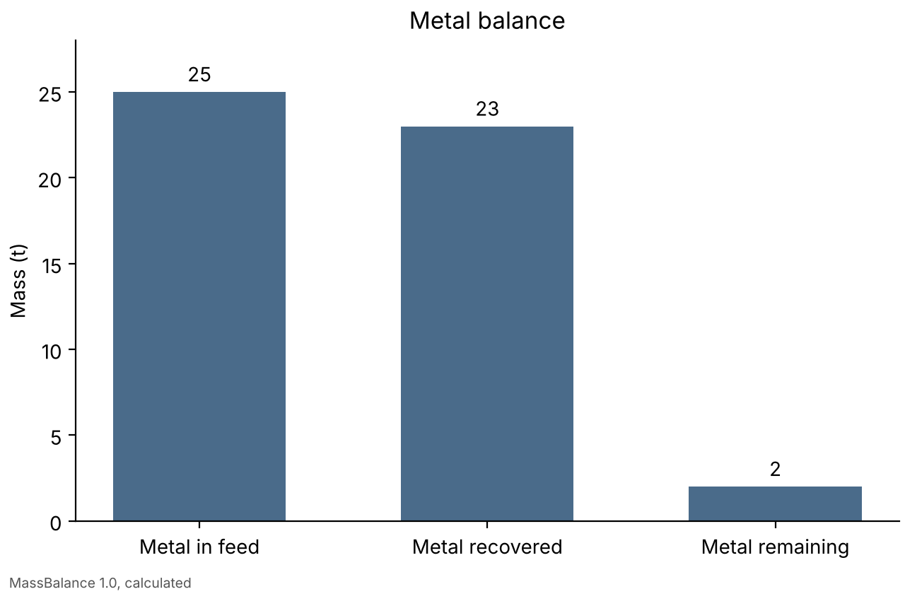
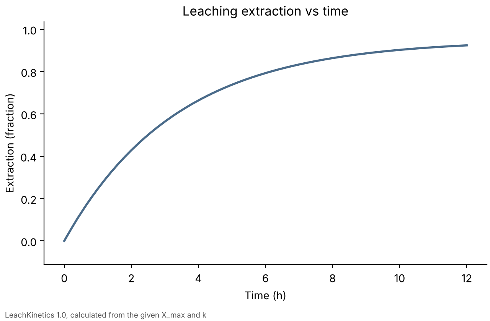

<div align="center">

# MetallurgyPy

**Engineering Metallurgy with Python** : la métallurgie de l'ingénieur avec Python

Calculs de procédés avec unités vérifiées et résultats traçables (hydrométallurgie, traitement
des minerais, électrolyse), et une application de bureau.

[](https://github.com/Mudiambat13/MetallurgyPy/actions/workflows/tests.yml)
[](https://github.com/Mudiambat13/MetallurgyPy/actions/workflows/docs.yml)


[](LICENSE)

[Documentation](https://mudiambat13.github.io/MetallurgyPy/fr/) ·
[English](README.md)

</div>

---

MetallurgyPy comprend deux parties qui partagent le même code :

- **MetallurgyPy Core** (`metallurgypy`) : une bibliothèque Python **sans dépendance obligatoire**.
  Bilan de matière, réactifs, électrolyse, flottation, filtration, lixiviation, extraction par
  solvant, thermodynamique et statistiques, chacun sous forme de modèle documenté et testé.
- **MetallurgyPy Studio** (`metallurgypy_studio`) : une application de bureau PySide6 qui génère ses
  formulaires depuis le registre du Core, trace les résultats, importe des données, compare des
  scénarios et produit des rapports. Elle n'appelle que le Core : aucune équation dans un widget.

> [!IMPORTANT]
> MetallurgyPy est en **pré-alpha**. Les modèles sont des relations classiques de manuel,
> vérifiées par des calculs à la main et des cas limites analytiques, **pas validées sur des données
> d'usine ou de laboratoire**, et non relues par un expert indépendant. Ce n'est pas un simulateur de
> procédés et cela ne remplace pas un DCS, un automate ou un SCADA. Rien n'est publié sur PyPI.

## Pourquoi MetallurgyPy

| Atout | Ce que cela signifie |
|---|---|
| **Unités vérifiées** | Un `Quantity` porte son unité. Une mauvaise dimension ou une unité inconnue lève une erreur claire au lieu de donner un faux nombre. |
| **Aucun arrondi en cachette** | Les résultats gardent leur pleine précision. L'arrondi n'existe que pour l'affichage. |
| **Chaque résultat s'explique** | Modèle, version, équations, hypothèses, entrées, tolérances et horodatage accompagnent le résultat. |
| **L'incertitude est de première classe** | Propagation de l'incertitude de mesure (GUM, premier ordre, corrélations), recoupement Monte Carlo, et part de chaque entrée dans le résultat. |
| **Calculs enregistrables et revérifiables** | Fichiers JSON versionnés, recalculés à la réouverture, jamais exécutés. |
| **Léger par conception** | Le Core n'utilise que la bibliothèque standard. Graphiques, import Excel et interface sont des extras optionnels. |

## Installation

MetallurgyPy n'est pas encore sur PyPI. Installez-le depuis un clone :

```bash
git clone https://github.com/Mudiambat13/MetallurgyPy.git
cd MetallurgyPy

pip install -e .                 # Core seul : aucune dépendance
pip install -e ".[gui]"          # Core + Studio (PySide6, pyqtgraph, matplotlib)
```

Extras : `visualization` (matplotlib : graphiques, PDF), `excel` (openpyxl : fichiers `.xlsx`),
`gui` (Studio), `dev` (tests et qualité), `docs` (MkDocs). Python 3.10 ou plus récent.
Lancez l'application avec `metallurgypy-studio`.

## Démarrage rapide

```python
from metallurgypy.core import Quantity
from metallurgypy.mass_balance import MassBalance

resultat = MassBalance(
    feed_mass=Quantity(1000, "t"),
    feed_grade=Quantity(2.5, "%"),
    recovery=Quantity(92, "%"),
).calculate()

print(resultat.metal_recovered)  # 23.0 t
print(resultat.metal_remaining)  # 2.0 t
print(resultat.provenance.equations[0])  # m_feed = F * g
```

Avec incertitude (valeurs fictives) :

```python
from metallurgypy.precision import Measurement, format_with_uncertainty, propagate_model

mesures = {
    "feed_mass": Measurement(1000, "t", 5),
    "feed_grade": Measurement(2.5, "%", 0.05),
    "recovery": Measurement(92, "%", 1),
}
sortie = propagate_model("mass_balance.recovery", mesures).outputs["metal_recovered"]
print(
    format_with_uncertainty(sortie.value, sortie.standard_uncertainty), sortie.unit
)  # 23.00(54) t
```

La teneur, et non la pesée, domine l'incertitude du métal récupéré (74 % de la variance).

### Aperçu des sorties

Graphiques et rapport réels de la bibliothèque (données illustratives).

<p align="center">
  
  
</p>

## Contenu

| Module | Modèles | Contenu |
|---|---|---|
| `mass_balance` | 2 | Bilan de métal ; bilan à deux produits ; mode `high_precision` en arithmétique exacte |
| `reagents` | 3 | Dilution, conversion massique/molaire, consommation de réactif |
| `electrowinning` | 1 | Loi de Faraday : masse déposée, rendement de courant, densité de courant |
| `flotation` | 2 | Bilan concentré/rejets, cinétique du premier ordre |
| `filtration` | 2 | Filtration à pression constante, humidité du gâteau |
| `hydrometallurgy` | 4 | Rendement de lixiviation, cinétique, neutralisation, précipitation |
| `solvent_extraction` | 4 | Un étage, stripping, contre-courant (Kremser), étages requis ; McCabe–Thiele |
| `thermodynamics` | 3 | Énergie de Gibbs et constante d'équilibre, pH d'acides forts et faibles (idéal) |
| `statistics`, `precision`, `data_io`, `comparison`, `reports`, `projects` | API | Outils statistiques, incertitudes, import de données, comparaison, rapports, projets |

## Exactitude et limites

Trois notions restent séparées : la **précision numérique**, l'**incertitude de mesure** et
l'**exactitude du modèle**. La bibliothèque traite les deux premières ; la troisième est de votre
responsabilité, et ces modèles sont simplifiés (coefficients de distribution constants, solutions
idéales, étages d'équilibre, cinétiques du premier ordre). Voir l'
[audit scientifique](https://mudiambat13.github.io/MetallurgyPy/fr/audit/).

## Documentation

**<https://mudiambat13.github.io/MetallurgyPy/fr/>** : installation, démarrage rapide, concepts,
précision et incertitude, méthodes scientifiques, Studio, import/comparaison/rapports/projets, audit.
Les pages de référence détaillées (API générée) sont en anglais.

## Développement et contribution

```bash
pip install -e ".[dev]"
pytest
ruff check . && ruff format --check .
mypy
```

Les règles de contribution sont dans la [documentation](https://mudiambat13.github.io/MetallurgyPy/fr/contribuer/),
le [code de conduite](CODE_OF_CONDUCT.md) et la [politique de sécurité](SECURITY.md).

## Licence

[MIT](LICENSE).
