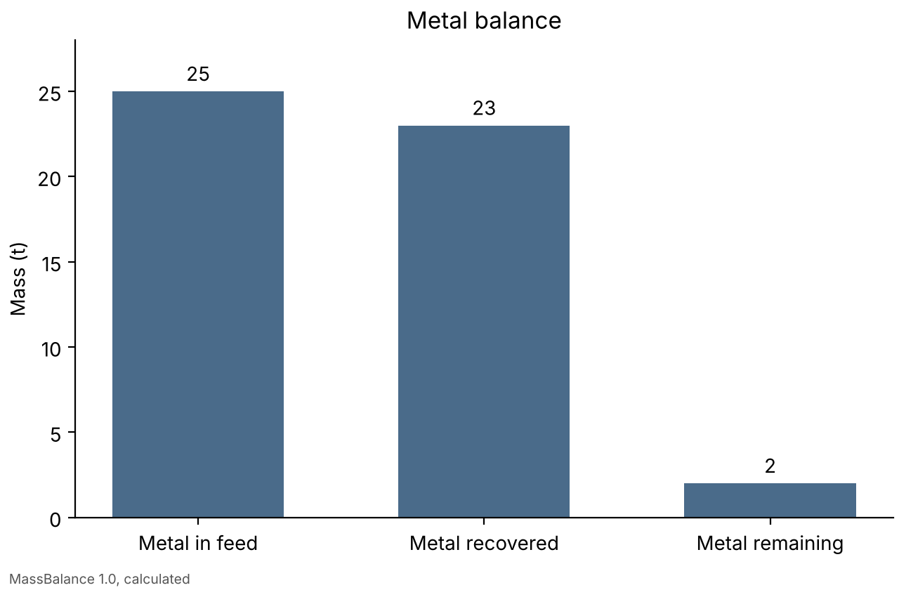
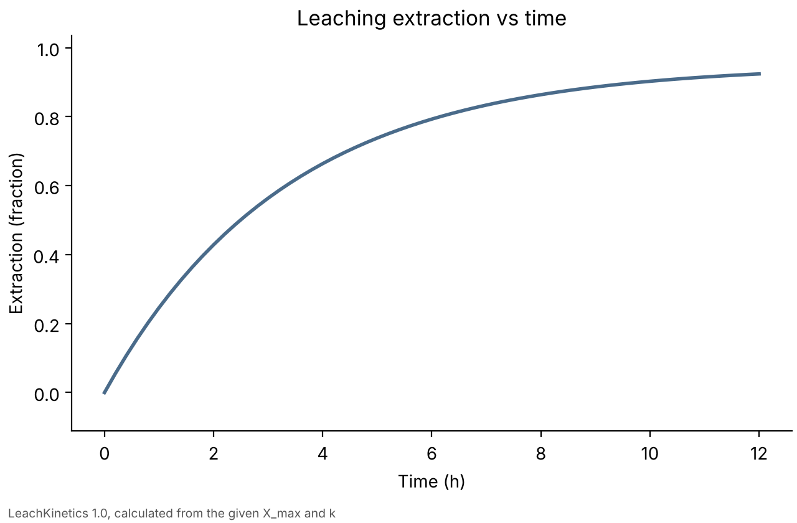
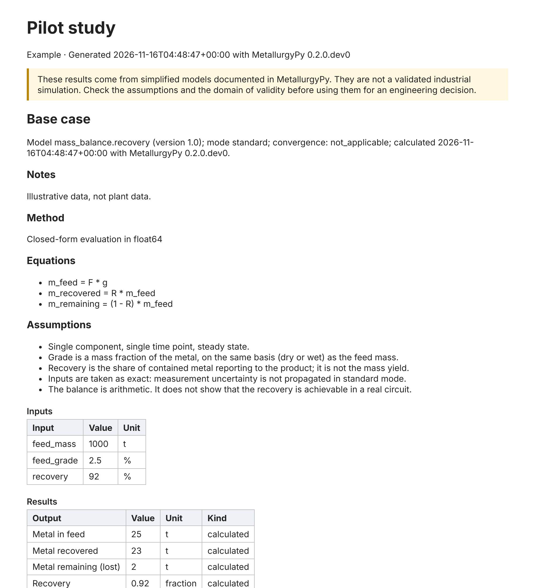

<div align="center">

# MetallurgyPy

**Engineering Metallurgy with Python**

Unit-checked, traceable calculations for hydrometallurgy, mineral processing and electrowinning,
with a desktop application on top.

[](https://github.com/Mudiambat13/MetallurgyPy/actions/workflows/tests.yml)
[](https://github.com/Mudiambat13/MetallurgyPy/actions/workflows/docs.yml)


[](LICENSE)

[Documentation](https://mudiambat13.github.io/MetallurgyPy/) ·
[Quick start](#quick-start) ·
[Modules](#what-is-inside) ·
[Limits](#accuracy-and-limits) ·
[Contributing](#contributing) ·
[Français](README.fr.md)

</div>

---

MetallurgyPy has two parts that share one code base:

- **MetallurgyPy Core** (`metallurgypy`): a pure-Python library with **no required dependency**.
  Mass balance, reagents, electrowinning, flotation, filtration, leaching, solvent extraction,
  thermodynamics and statistics, each as a documented, tested model.
- **MetallurgyPy Studio** (`metallurgypy_studio`): a PySide6 desktop application that builds its
  forms from the Core registry, plots results, imports data, compares scenarios and writes reports.
  It only calls the Core; there is no equation inside a widget.

> [!IMPORTANT]
> MetallurgyPy is **pre-alpha**. The models are textbook relations, checked against hand calculations
> and analytic limits, **not validated against plant or laboratory data**, and not reviewed by an
> independent expert. It is not a process simulator and does not replace DCS/PLC/SCADA systems.
> Read [Accuracy and limits](#accuracy-and-limits) before relying on a result.
> Nothing is published on PyPI yet.

## Why MetallurgyPy

| Feature | What it means |
|---|---|
| **Units are checked** | A `Quantity` carries its unit. Wrong dimensions and unknown units raise a clear error instead of returning a wrong number. |
| **Nothing is rounded behind your back** | Results keep full precision. Rounding exists only for display. |
| **Every result explains itself** | Each result carries its model, version, equations, assumptions, inputs, tolerances and timestamp. |
| **Uncertainty is first class** | Propagate measurement uncertainty (GUM, first order, with correlations), cross-check with Monte Carlo, and see which input drives the result. |
| **Calculations can be saved and re-checked** | Versioned JSON files that are re-computed on reopening, never executed. |
| **Light by design** | The Core needs only the standard library. Charts, Excel import and the GUI are optional extras. |

## Install

MetallurgyPy is not on PyPI yet. Install it from a clone:

```bash
git clone https://github.com/Mudiambat13/MetallurgyPy.git
cd MetallurgyPy

pip install -e .                 # Core only: no dependency
pip install -e ".[gui]"          # Core + Studio (PySide6, pyqtgraph, matplotlib)
```

| Extra | Adds | For |
|---|---|---|
| *(none)* | nothing | the Core library |
| `visualization` | matplotlib | charts, PNG/SVG export, PDF reports |
| `excel` | openpyxl | reading `.xlsx` files |
| `gui` | PySide6, pyqtgraph, matplotlib | MetallurgyPy Studio |
| `dev` | pytest, mypy, ruff, build, twine, … | development |
| `docs` | mkdocs, mkdocs-material | building the documentation |

Python 3.10 or newer. Launch the desktop application with `metallurgypy-studio`.

## Quick start

### A metal balance, with units

```python
from metallurgypy.core import Quantity
from metallurgypy.mass_balance import MassBalance

result = MassBalance(
    feed_mass=Quantity(1000, "t"),
    feed_grade=Quantity(2.5, "%"),
    recovery=Quantity(92, "%"),
).calculate()

print(result.metal_recovered)  # 23.0 t
print(result.metal_remaining)  # 2.0 t
print(result.provenance.equations[0])  # m_feed = F * g
```

### Units are checked, not guessed

A bare number uses the documented default unit of the parameter (grades and recoveries are
**fractions**), so `2.5` means 250 %, and it is refused:

```python
from metallurgypy.mass_balance import MassBalance

try:
    MassBalance(1000, 2.5, 92).calculate()
except Exception as error:
    print(type(error).__name__)  # InvalidParameterError
```

### How uncertain is the answer?

```python
from metallurgypy.precision import Measurement, format_with_uncertainty, propagate_model

measured = {
    "feed_mass": Measurement(1000, "t", 5),
    "feed_grade": Measurement(2.5, "%", 0.05),
    "recovery": Measurement(92, "%", 1),
}
out = propagate_model("mass_balance.recovery", measured).outputs["metal_recovered"]

print(format_with_uncertainty(out.value, out.standard_uncertainty), out.unit)  # 23.00(54) t
for name, share in sorted(out.contributions.items(), key=lambda kv: -kv[1]):
    print(f"{name}: {share:.0%}")  # feed_grade: 74%, recovery: 22%, feed_mass: 5%
```

The grade analysis, not the weighing, dominates the uncertainty of the recovered metal.
Here the standard uncertainty is 0.54 t, written `23.00(54)`.

### Run any model by its id

Every model is registered with its parameters, units and an illustrative example, which is how
Studio builds its forms:

```python
from metallurgypy.registry import get_model, list_models

print(len(list_models()), "models")  # 21 models

spec = get_model("solvent_extraction.countercurrent_kremser")
for item in spec.run(spec.example).outputs():
    print(f"{item.label}: {item.quantity}")
# Extraction factor E = D * O/A: 2.0 ratio
# Raffinate concentration: 0.3333333333333333 g/L
# Loaded organic concentration: 4.666666666666667 g/L
# Extraction (fraction): 0.9333333333333333 fraction
```

The example values are fictional and only illustrate the call.

### Save a calculation and check it later

```python
from metallurgypy.core import Quantity
from metallurgypy.mass_balance import MassBalance
from metallurgypy.records import load_record, save_record, verify

result = MassBalance(Quantity(1000, "t"), Quantity(2.5, "%"), Quantity(92, "%")).calculate()
path = save_record("balance.mpy.json", result, name="Demo", overwrite=True)

print(verify(load_record(path)))  # [] : the installed model reproduces the saved result
```

Files are never overwritten unless you pass `overwrite=True`.

### What the output looks like

Charts and reports below are real output of the library (illustrative data, generated by
`tools/make_screenshots.py`).

<p align="center">
  
  
</p>

<p align="center">
  
</p>

> Screenshots of the Studio window will be added once the application has been run on a real
> display: `tools/take_studio_screenshots.py` produces them, and the CI `gui` job uploads them as
> an artifact.

## What is inside

| Module | Models | Content |
|---|---|---|
| `mass_balance` | 2 | Metal balance from recovery; two-product balance from three grades; exact-arithmetic `high_precision` mode |
| `reagents` | 3 | Dilution, mass to molar concentration, reagent consumption |
| `electrowinning` | 1 | Faraday's law: deposited mass, current efficiency, production rate, current density |
| `flotation` | 2 | Concentrate/tailings balance, first-order kinetics |
| `filtration` | 2 | Constant-pressure cake filtration, cake moisture |
| `hydrometallurgy` | 4 | Leaching yield, first-order leach kinetics, neutralization, precipitation yield |
| `solvent_extraction` | 4 | Single stage, stripping, counter-current (Kremser), stages required; McCabe–Thiele stepping on a user-supplied isotherm |
| `thermodynamics` | 3 | Gibbs energy and equilibrium constant, pH of strong and weak acids (ideal) |
| `statistics` | API | `describe`, `linear_regression`, `correlation`, `detect_outliers`, `moving_average`, `variability` |
| `precision` | API | `Measurement`, GUM propagation, Monte Carlo, sensitivity, significant-figure formatting |
| `data_io` | API | CSV / JSON / `.xlsx` import with a per-row rejection report; batch runs |
| `comparison`, `reports`, `projects` | API | Scenario comparison, HTML and PDF reports, project folders |

Each model has its own page with the equations, assumptions and validity limits in the
[documentation](https://mudiambat13.github.io/MetallurgyPy/scientific_methods/).

## MetallurgyPy Studio

```bash
pip install -e ".[gui]"
metallurgypy-studio
```

- forms generated from the registry, with a unit selector and an optional standard uncertainty per input;
- results with their kind (calculated, estimated or measured), warnings, assumptions and equations;
- interactive charts, light and dark themes, CSV/JSON/PNG/SVG export;
- data import, scenario comparison, projects and HTML/PDF reports;
- calculations run on a worker thread, so the window never freezes.

Studio's logic (services and view models) is tested without Qt. The widgets are exercised by the
GUI job of the CI.

## Accuracy and limits

MetallurgyPy keeps three notions apart, and the documentation does too:

1. **Numerical precision**: how exactly the computer evaluates the equation.
2. **Measurement uncertainty**: how well the inputs are known.
3. **Model accuracy**: how well the equation describes your process.

Only the first two are handled by the library. The third is your responsibility, and these models
are simplified: constant distribution coefficients, ideal solutions, equilibrium stages, first-order
kinetics. See the [scientific audit](https://mudiambat13.github.io/MetallurgyPy/project/scientific_audit/)
for what has and has not been verified, and the
[security notes](https://mudiambat13.github.io/MetallurgyPy/project/security/) for how files are read.

## Documentation

**<https://mudiambat13.github.io/MetallurgyPy/>**: installation, tutorials, one page per model with
its equations, the generated API reference, the Studio guide and the project notes.

```bash
pip install -e ".[docs]"
mkdocs serve                     # http://127.0.0.1:8000
```

## Development

```bash
pip install -e ".[dev]"

pytest                           # GUI tests skip themselves without PySide6
ruff check . && ruff format --check .
mypy                             # strict
python tools/gen_model_reference.py --check
python tools/gen_api_reference.py --check
```

| Path | Content |
|---|---|
| `src/metallurgypy/` | Core library |
| `studio/metallurgypy_studio/` | Desktop application |
| `tests/` | Core, process models, precision, workflows, Studio logic, GUI, documentation snippets |
| `docs/`, `mkdocs.yml` | Documentation site (MkDocs Material) |
| `tools/` | Generators for the model and API documentation pages |
| `examples/` | Runnable examples |
| `specs/` | Technical specification (French) |
| `.github/workflows/` | CI (tests, quality, GUI, packaging) and Pages deployment |

## Contributing

Contributions from engineers, researchers, teachers and developers are welcome. The ground rules
(documented equations and assumptions, no invented constants or data, Core free of GUI imports) are
in [CONTRIBUTING](docs/contributing.md). Please follow the [code of conduct](CODE_OF_CONDUCT.md).
Report vulnerabilities as described in [SECURITY](SECURITY.md).

See the [changelog](CHANGELOG.md) for what changed between versions.

## License

[MIT](LICENSE).
