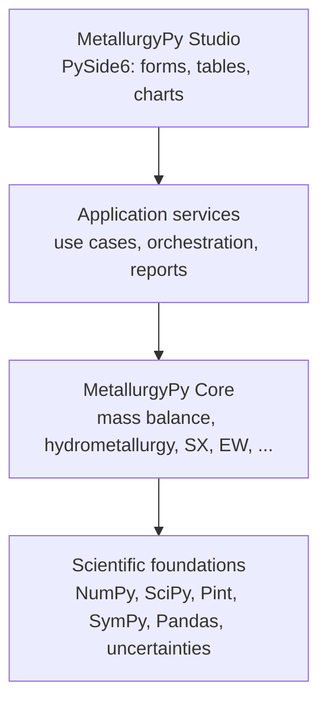

# Architecture

MetallurgyPy is built in layers. Each layer depends only on the ones below it.



## Core principle

The `metallurgypy` package installs and runs **without PySide6**. Studio is an optional extra and consumes the Core public API. Scientific equations never live in widgets.

## Package layout

```text
src/metallurgypy/
├── core/          units, constants, exceptions, validation, results, provenance
├── precision/     numerical modes, uncertainty, measurements, tolerances, sensitivity
├── mass_balance/
├── hydrometallurgy/
├── solvent_extraction/
├── electrowinning/
├── flotation/
├── filtration/
├── reagents/
├── thermodynamics/
├── statistics/
└── visualization/

studio/metallurgypy_studio/
├── views/  viewmodels/  services/  widgets/  workers/  resources/
```

The tree is a starting proposal. Folders are created when they hold real code, not in advance.

## Core responsibilities

- unit handling and conversion (Pint)
- input validation
- documented physical constants
- custom exceptions
- result objects and provenance

Minimum exception hierarchy:

```text
MetallurgyPyError
├── InvalidParameterError
├── UnitConversionError
├── DimensionError
├── CalculationError
│   └── ConvergenceError
└── ModelDomainError
```

The tree above shows the proposed hierarchy; the exact inheritance is confirmed in Phase 1.

## Studio architecture

Studio follows Model-View-ViewModel (or an equivalent Qt-adapted separation):

- widgets contain no scientific equations
- application services call the Core public API
- long calculations run off the GUI thread
- errors are turned into readable messages, with technical details kept in logs
- results can be tested without starting the GUI
- a **model registry** lets the interface discover available calculators from controlled metadata, so forms are generated from parameter schemas instead of being hand-coded per model

!!! danger "Security rule"
    Studio never executes arbitrary Python code coming from an imported project file.

## Dependencies

| Tool | Role |
|---|---|
| NumPy, SciPy | numerical computing |
| Pandas | tabular data |
| SymPy | symbolic computation |
| Pint | units and dimensions |
| Pydantic | data validation and schemas |
| uncertainties | uncertainty propagation (optional extra) |
| PySide6, pyqtgraph, Matplotlib | Studio and plotting (optional extras) |
| openpyxl | Excel import/export |
| SQLite | project metadata and history |
| Pytest, Hypothesis, Ruff, MyPy | quality tooling |
| MkDocs | this documentation |

Dependency versions are checked for compatibility before being pinned. A dependency is added only with a technical justification.

## Out of scope

Replacing a DCS/PLC/SCADA, driving industrial equipment, providing operating safety instructions, guaranteeing industrial performance without experimental validation, and replacing a rigorously calibrated process simulator. Real-time acquisition and control functions are excluded from the MVP.
