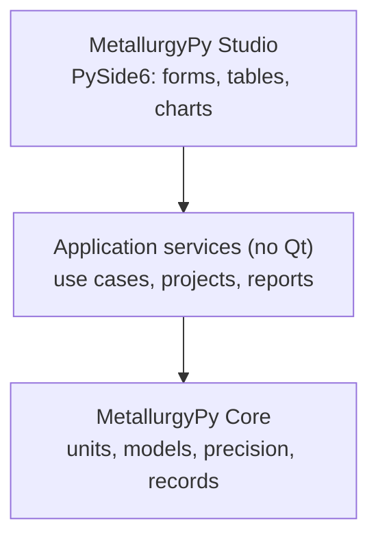

# Architecture

MetallurgyPy is built in layers. Each layer depends only on the ones below it.



## Core principle

The `metallurgypy` package installs and runs **without PySide6**. Studio is an optional extra and consumes the Core public API. Scientific equations never live in widgets.

## Package layout

```text
src/metallurgypy/
├── core/            units, constants, exceptions, validation, results, provenance
├── precision/       uncertainty, sensitivity, significant figures, tolerances
├── mass_balance/  reagents/  electrowinning/  flotation/  filtration/
├── hydrometallurgy/  solvent_extraction/  thermodynamics/  statistics/
├── data_io/  comparison/  reports/  projects/  visualization/
├── registry.py      model registry
└── records.py       save, reopen, verify, export

studio/metallurgypy_studio/
└── views/  viewmodels/  services/  widgets/  workers/  resources/
```

## Core responsibilities

- unit handling and conversion (an internal engine with exact ratios and dimensions; no third-party package)
- input validation
- documented physical constants
- custom exceptions
- result objects and provenance

Minimum exception hierarchy:

```text
MetallurgyPyError
├── InvalidParameterError
├── UnitConversionError
├── DimensionError
├── CalculationError
│   └── ConvergenceError
├── ModelDomainError
└── RecordFormatError
```

`InvalidParameterError` is also a `ValueError`. `DataImportError` and `ProjectError` are added by the import and project modules.

## Studio architecture

Studio follows Model-View-ViewModel (or an equivalent Qt-adapted separation):

- widgets contain no scientific equations
- application services call the Core public API
- long calculations run off the GUI thread
- errors are turned into readable messages, with technical details kept in logs
- results can be tested without starting the GUI
- a **model registry** lets the interface discover available calculators from controlled metadata, so forms are generated from parameter schemas instead of being hand-coded per model

!!! danger "Security rule"
    Studio never executes arbitrary Python code coming from an imported project file.

## Dependencies

The Core has **no required dependency**: it uses the Python standard library only.

| Package | Role | Extra |
|---|---|---|
| matplotlib | Charts, PNG/SVG export, PDF reports | `visualization` |
| openpyxl | Reading `.xlsx` files | `excel` |
| PySide6, pyqtgraph | Studio and interactive charts | `gui` |
| pytest, mypy, ruff, build, twine | Quality tooling and packaging | `dev` |
| MkDocs, Material | This documentation | `docs` |

SQLite (standard library) stores the project history. A dependency is added only with a technical justification.

## Out of scope

Replacing a DCS/PLC/SCADA, driving industrial equipment, providing operating safety instructions, guaranteeing industrial performance without experimental validation, and replacing a rigorously calibrated process simulator. Real-time acquisition and control functions are excluded from the MVP.
