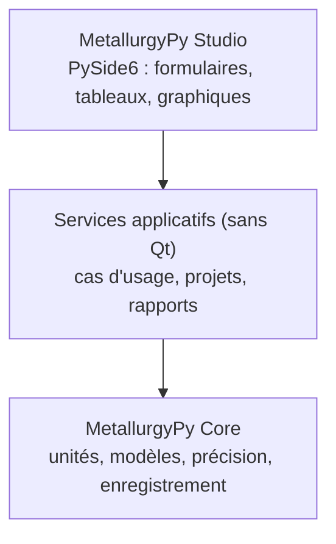

# Concepts : architecture, unités, résultats, fichiers

## Architecture en couches

Chaque couche ne dépend que de celles du dessous.



- Le paquet `metallurgypy` s'installe et fonctionne **sans PySide6** et **sans aucune dépendance** : il n'utilise que la bibliothèque standard de Python.
- Studio est un extra optionnel qui appelle l'API publique du Core. **Aucune équation scientifique n'est dans un widget.**
- Les services et les vues-modèles de Studio ne dépendent pas de Qt : ils se testent sans écran.
- Un **registre de modèles** décrit chaque calculateur (paramètres, unités, exemple). Studio génère ses formulaires à partir de ce registre au lieu de les coder à la main.

Disposition du code :

```text
src/metallurgypy/
├── core/            unités, constantes, exceptions, validation, résultats, traçabilité
├── precision/       incertitudes, sensibilité, chiffres significatifs, tolérances
├── mass_balance/  reagents/  electrowinning/  flotation/  filtration/
├── hydrometallurgy/  solvent_extraction/  thermodynamics/  statistics/
├── data_io/  comparison/  reports/  projects/  visualization/
├── registry.py      registre des modèles
└── records.py       enregistrement, relecture, vérification, export

studio/metallurgypy_studio/
└── views/  viewmodels/  services/  widgets/  workers/  resources/
```

!!! danger "Règle de sécurité"
    Studio n'exécute jamais de code Python provenant d'un fichier de projet importé. Un fichier est de la donnée.

## Unités

MetallurgyPy a son propre moteur d'unités (rapports exacts, dimensions, température en °C affine). Un `Quantity` porte sa valeur et son unité :

```python
from metallurgypy.core import Quantity

masse = Quantity(2.5, "t")
print(masse.to("kg"))  # 2500.0 kg
```

- Une unité inconnue ou une dimension incompatible lève une erreur claire au lieu de donner un faux nombre.
- Un nombre « nu » prend l'**unité par défaut documentée** du paramètre. Convention uniforme : **teneurs, récupérations, rendements et puretés sont des fractions** (0,025 pour 2,5 %) ; les masses sont en **tonnes**.
- Pour employer un pourcentage, écrivez `Quantity(2.5, "%")`. Les `ppm` et les `g/t` sont des teneurs massiques égales à 1e-6.

## Résultats et traçabilité

Un résultat contient ses valeurs **non arrondies** et sa `provenance` : identifiant et version du modèle, méthode, équations, hypothèses, entrées, tolérances, mode de calcul, convergence, version de MetallurgyPy et horodatage UTC. L'arrondi n'existe que pour l'affichage (dans Studio, le réglage de précision d'affichage ne change jamais les valeurs, les fichiers ni les exports).

Chaque valeur de sortie est étiquetée : **calculée**, **estimée** ou **mesurée**. Une interface peut ainsi ne jamais présenter une mesure comme un calcul.

## Fichiers de calcul

Un calcul s'enregistre en JSON versionné (`*.mpy.json`, format `metallurgypy.calculation`, version 1) :

- les nombres gardent leur représentation exacte aller-retour ; les valeurs non finies sont refusées ;
- l'écriture est atomique, et **un fichier existant n'est jamais écrasé** sans `overwrite=True` ;
- à la réouverture, le modèle est cherché par son identifiant dans le registre puis **recalculé** ; `verify()` compare ensuite le résultat enregistré à un calcul neuf et liste les différences ;
- les incertitudes d'entrée, les corrélations et les incertitudes de sortie sont enregistrées avec le calcul quand elles ont été propagées ;
- les exports CSV neutralisent les cellules de texte qui commencent par `=`, `+`, `-` ou `@` (injection de formules dans un tableur).

## Erreurs

```text
MetallurgyPyError
├── InvalidParameterError   (aussi une ValueError)
├── UnitConversionError
├── DimensionError
├── CalculationError
│   └── ConvergenceError
├── ModelDomainError
└── RecordFormatError
```

Les modules d'import et de projets ajoutent `DataImportError` et `ProjectError`.

## Ce qui est hors périmètre

Remplacer un DCS, un automate ou un SCADA, piloter des équipements, donner des consignes de sécurité d'exploitation, garantir une performance industrielle sans validation expérimentale, et remplacer un simulateur de procédés rigoureusement calibré. L'acquisition en temps réel et la conduite de procédé sont exclues.
