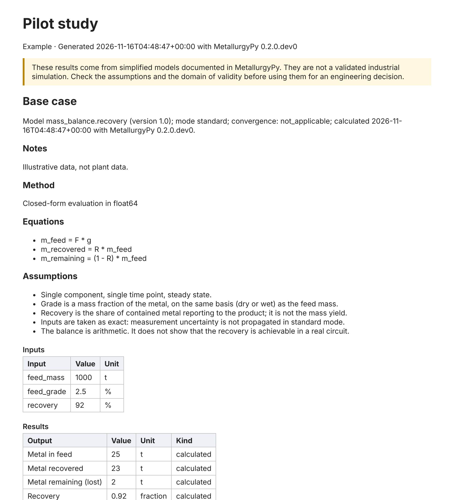

# Données, comparaison, rapports et projets

Ces outils transforment des fichiers en calculs validés, puis des calculs en livrables. Ils sont tous dans le Core (aucune interface graphique nécessaire) et Studio les expose dans ses pages **Data Import** et **Projects**. Les exemples utilisent des données fictives.

## Importer un fichier de données

`read_table` lit `.csv`, `.tsv`, `.txt`, `.json` et `.xlsx` (ce dernier demande `pip install -e ".[excel]"`). Il détecte le séparateur de colonnes, et la virgule décimale quand le séparateur n'est pas une virgule. Le fichier source est seulement lu, jamais modifié.

Vous dites ce que représente chaque colonne. Les unités ne sont **jamais devinées en silence** : une colonne numérique exige une unité explicite.

```python
import tempfile
from pathlib import Path

from metallurgypy.data_io import (
    ColumnMapping,
    import_table,
    read_table,
    run_batch,
    write_rejected_csv,
)

dossier = Path(tempfile.mkdtemp())
(dossier / "analyses.csv").write_text(
    "echantillon;masse [t];teneur [%];rec [%]\n"
    "A;1000;2,5;92\n"
    "B;900;2,1;90\n"
    "C;800;2,0;91\n"
    "D;700;1,9;89\n"
    "E;abc;1,7;88\n",
    encoding="utf-8",
)

table = read_table(dossier / "analyses.csv")  # séparateur ';' et virgule décimale détectés
rapport = import_table(
    table,
    [
        ColumnMapping("echantillon", "sample", kind="text"),
        ColumnMapping("masse [t]", "feed_mass", "t", minimum=0.0),
        ColumnMapping("teneur [%]", "feed_grade", "%"),
        ColumnMapping("rec [%]", "recovery", "%", maximum=100.0),
    ],
)
print(len(rapport.rows), "valides ;", len(rapport.rejected), "rejetée(s)")
for ligne in rapport.rejected:
    print(ligne.row_number, ligne.reasons)
```

Les lignes inutilisables sont **signalées avec la raison**, jamais supprimées en silence. Écrivez-les dans un nouveau fichier avec `write_rejected_csv(chemin, rapport)`.

Lancez un modèle enregistré sur chaque ligne valide. Une ligne en échec donne un élément d'erreur ; les autres s'exécutent quand même :

```python
elements = run_batch("mass_balance.recovery", rapport.rows)
for element in elements:
    print(element.row_number, element.result.get("metal_recovered").value)
```

## Comparer des scénarios

```python
from metallurgypy.comparison import compare, comparison_to_csv
from metallurgypy.core import Quantity
from metallurgypy.registry import get_model

modele = get_model("mass_balance.recovery")


def scenario(recuperation):
    return modele.run(
        {
            "feed_mass": Quantity(1000, "t"),
            "feed_grade": Quantity(2.5, "%"),
            "recovery": Quantity(recuperation, "%"),
        }
    )


comparaison = compare({"base": scenario(92), "amélioré": scenario(95)})
ligne = next(r for r in comparaison.outputs() if r.name == "metal_recovered")
print(ligne.difference["amélioré"], ligne.relative_difference["amélioré"])
print(comparison_to_csv(comparaison).splitlines()[0])
```

Les valeurs sont converties dans l'unité du scénario de référence. Les entrées identiques dans tous les scénarios sont omises. Une grandeur d'unité incompatible est signalée, pas forcée ; des scénarios issus de modèles ou de modes différents reçoivent un avertissement.

## Rapports

Un rapport garde séparées trois choses : les valeurs **calculées ou estimées** par un modèle, les **observations** que vous avez mesurées (affichées telles quelles, jamais calculées) et les **incertitudes** (seulement si elles ont été propagées). Il porte le modèle, la version, les équations, les hypothèses, les avertissements, la date, la version du logiciel et un rappel que ces modèles sont simplifiés.

```python
from metallurgypy.reports import ReportEntry, build_report, render_html, write_html

entree = ReportEntry(
    "Cas de base",
    scenario(92),
    observations={"Teneur mesurée du concentré": Quantity(24.1, "%")},
    notes="Données illustratives.",
)
document = build_report(
    [entree], title="Étude pilote", author="Jeanne Exemple", include_charts=False
)
texte_html = render_html(document)
assert "Observations (entered by the user" in texte_html
write_html(dossier / "rapport.html", document)
```

Tout texte est échappé en HTML. Les graphiques sont intégrés en SVG quand l'extra `visualization` est installé. `write_pdf` produit un PDF simple texte et tableaux (il demande Matplotlib ; les graphiques restent dans le rapport HTML). Le texte généré par la bibliothèque (titres de sections, avertissement) est en anglais.



## Projets

Un projet est un dossier : `project.json` (index versionné), `calculations/` (un `.mpy.json` par calcul) et `history.sqlite` (journal d'activité en ajout seul).

```python
from metallurgypy.projects import Project

projet = Project.create(dossier / "pilote", "Étude pilote", "Projet illustratif")
projet.add_calculation(scenario(92), "Cas de base", notes="fictif")
projet.add_calculation(scenario(95), "Récupération améliorée")

rouvert = Project.open(dossier / "pilote")
print([e.name for e in rouvert.entries()])
print([h.action for h in rouvert.history()])
rouvert.export_archive(dossier / "pilote.zip")
```

Règles de sûreté : les noms de fichiers viennent d'un identifiant assaini (jamais du texte brut de l'utilisateur) ; une entrée d'index qui pointe hors de `calculations/` est refusée ; retirer une entrée la retire seulement de la liste et conserve le fichier ; un dossier de projet n'est jamais écrasé.
