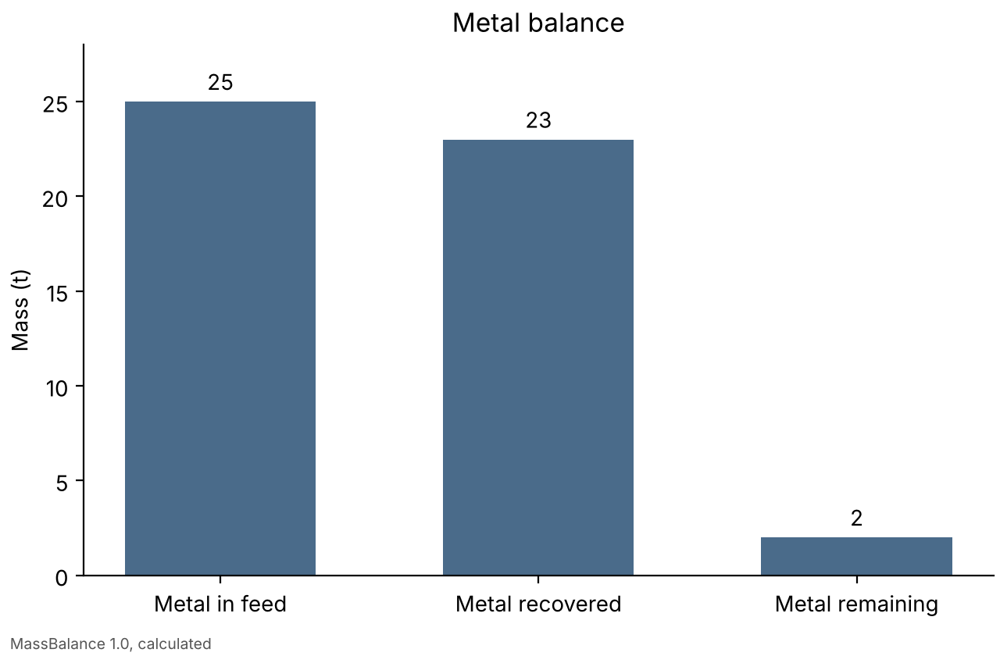
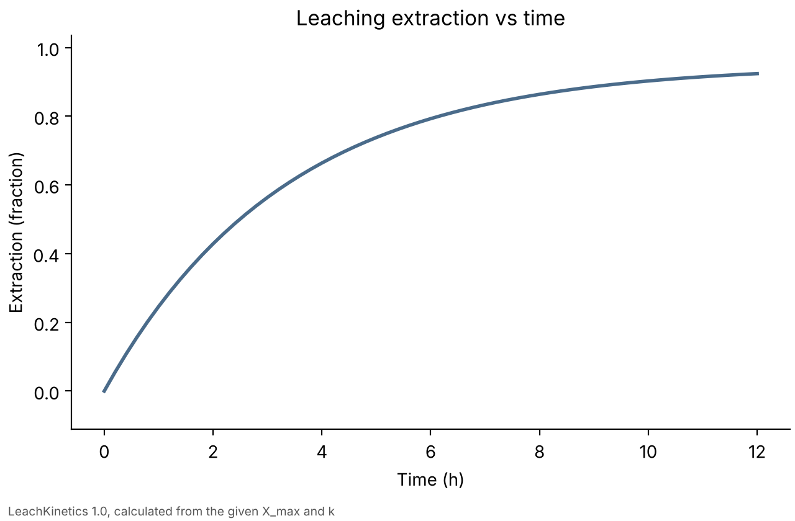
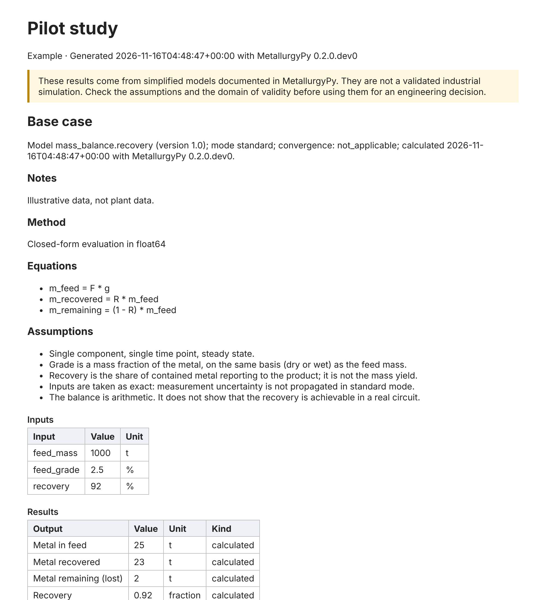

# MetallurgyPy Studio

Studio est l'application de bureau construite sur le Core. Elle vise Windows et Linux ; la compatibilité macOS reste possible.

!!! warning "Statut : écrite et testée sans écran"
    Studio est implémenté : tableau de bord, explorateur de modules, **espace de calcul** (21 modèles, formulaires générés, incertitude-type optionnelle par entrée, budget d'incertitude), **import de données**, **projets** (comparaison, rapports HTML/PDF, archive), graphique interactif, enregistrement et réouverture, exports CSV/JSON/PNG/SVG, thème clair/sombre et réglages. Toute la logique (services et vues-modèles) est testée sans Qt. Les widgets eux-mêmes n'ont **jamais été exécutés** par l'auteur, faute de PySide6 et d'écran dans l'environnement de construction : ils sont exercés par le job GUI de la CI (en mode hors écran) et demandent une première vérification manuelle sous Windows et Linux.

```bash
pip install -e ".[gui]"
metallurgypy-studio
```

## Technologie

PySide6 (Qt), pyqtgraph pour les graphiques interactifs et Matplotlib pour l'export de qualité publication. Les tableaux utilisent les widgets Qt natifs ; il n'y a pas de dépendance à Pandas.

## Les écrans

| Écran | Rôle |
|---|---|
| **Dashboard** | Version, accès rapide, calculs récents et calculs de la session. N'affiche que l'état réel, jamais de fausses statistiques industrielles |
| **Modules** | Les modules scientifiques avec leur description, leurs modèles et un lien vers la documentation |
| **Calculation** | Choisir un modèle, remplir un formulaire généré avec unités explicites et incertitudes-types optionnelles, calculer dans un fil d'exécution séparé, lire résultats, avertissements, hypothèses, détails et budget d'incertitude, voir le graphique, enregistrer, exporter |
| **Data Import** | CSV, TSV, JSON et XLSX ; association des colonnes avec unités explicites, détection des types, validation, rapport des lignes rejetées, calcul optionnel sur chaque ligne valide |
| **Projects** | Créer ou ouvrir un projet, y ajouter le calcul courant, le rouvrir, le retirer de la liste, comparer des scénarios, exporter une comparaison (CSV), un rapport HTML ou PDF et une archive du projet |
| **Settings** | Thème clair/sombre, précision d'affichage, dossier par défaut |

## Règles d'affichage honnête

- Les valeurs calculées, estimées et mesurées sont visuellement distinguées.
- Les unités sont toujours affichées à côté des valeurs.
- Les hypothèses et les avertissements sont visibles à côté des résultats, pas cachés dans des journaux.
- Aucune courbe ni aucun point n'est inventé. Les données d'exemple sont signalées comme fictives ou pédagogiques.
- La précision d'affichage ne modifie jamais les valeurs enregistrées.
- Les fichiers sources ne sont jamais écrasés sans confirmation.
- Les fichiers de projet importés sont de la donnée : ils ne peuvent pas exécuter de code Python.

## Aperçus

!!! info "Captures de l'application"
    Les captures de la fenêtre de Studio ne sont pas encore incluses : l'application n'a pas pu être lancée dans l'environnement où le code a été écrit. Le script `tools/take_studio_screenshots.py` les produit à partir de l'application réelle, et le job GUI de la CI les publie comme artefact (`studio-screenshots`). Les images ci-dessous sont, elles, de **vraies sorties de la bibliothèque** (générées par `tools/make_screenshots.py`).

**Graphique d'un bilan de métal** (export PNG du Core, avec l'exemple fictif du modèle) :



**Cinétique de lixiviation du premier ordre** (courbe issue du modèle, pas de points mesurés) :



**Rapport HTML** : modèle, version, hypothèses, entrées, résultats, avec la mise en garde sur les modèles simplifiés (début de la page) :



## Projets

Les projets utilisent un format versionné et documenté (`project.json`, version 1). SQLite conserve l'historique d'activité ; chaque calcul est son propre fichier `.mpy.json`. Voir [Données, comparaison, rapports et projets](flux.md).
