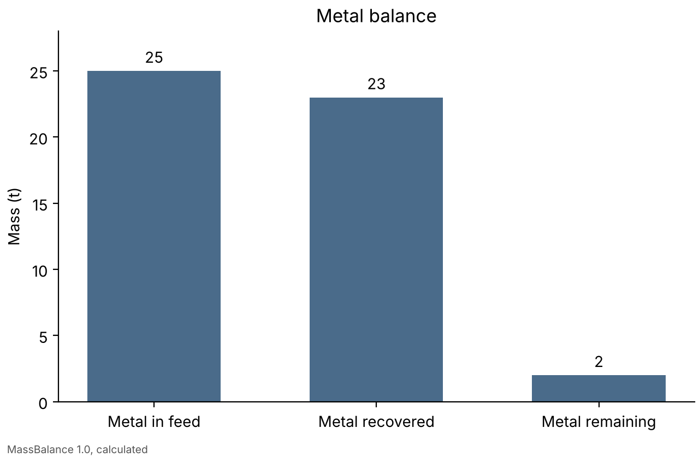
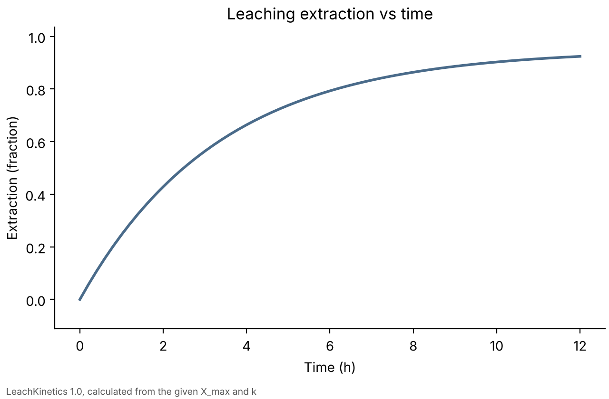
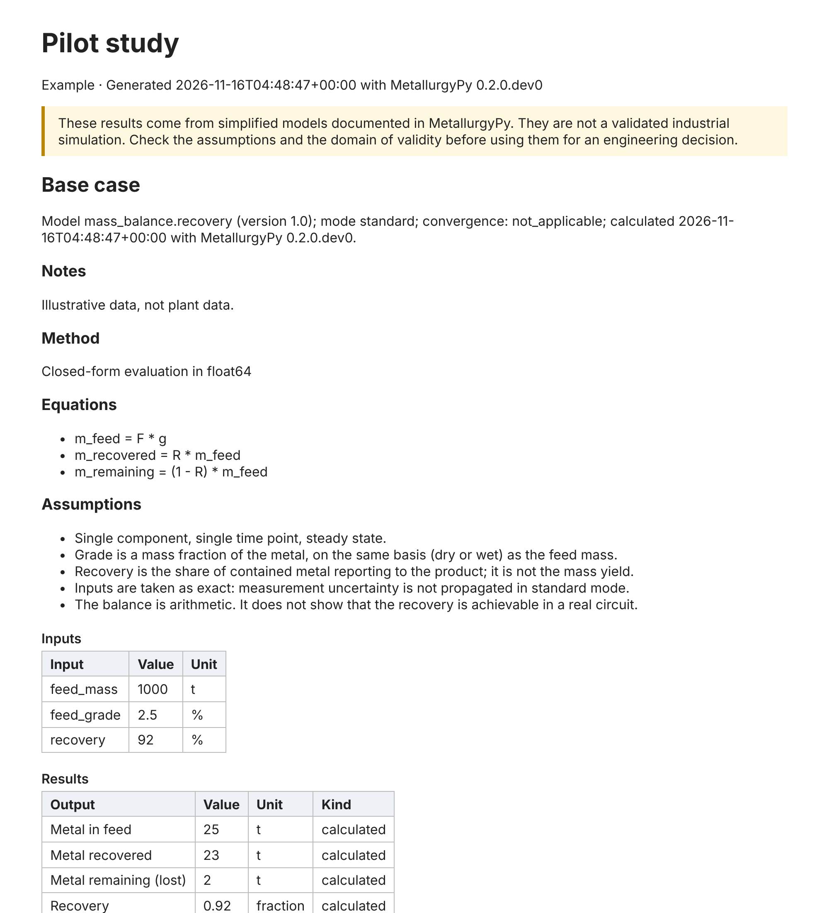

# MetallurgyPy Studio

Studio is the desktop application built on the Core. It targets Windows and Linux, with macOS compatibility kept possible.

!!! warning "Status: written and tested without a display"
    Studio is implemented: dashboard, module explorer, the **Calculation Workspace** (all 21 models, generated forms, optional standard uncertainty per input, uncertainty budget), **Data Import**, **Projects** (comparison, HTML/PDF reports, archive), interactive chart, save/reopen, CSV/JSON export, PNG/SVG export, light/dark theme and settings. All logic (services and view models) is tested without Qt. The widgets themselves were **never executed** by the author because the build environment had no PySide6 or display; they are exercised by the CI job (offscreen) and need a first manual check on Windows and Linux.

```bash
pip install "metallurgypy[gui]"
metallurgypy-studio
```

## Technology

PySide6 (Qt), pyqtgraph for interactive charts and Matplotlib for publication-quality export. Tables use Qt's own widgets; there is no Pandas dependency.

## Screens

| Screen | Status | Purpose |
|---|---|---|
| **Dashboard** | Implemented | Version, quick access, recent calculations and the session's calculations. Shows real state only, never fake industrial statistics |
| **Modules** | Implemented | The scientific modules with description, available models and a link to the documentation |
| **Calculation** | Implemented | Pick a model, fill a generated form with explicit units and optional standard uncertainties, calculate in a background thread, read results, warnings, assumptions, details and uncertainty budget, see the chart, save, export |
| **Data Import** | Implemented | CSV, TSV, JSON and XLSX; column mapping with explicit units, type detection, validation, rejected-rows report, optional model run on every valid row |
| **Projects** | Implemented | Create/open a project, add the current calculation, reopen, unlist, compare scenarios, export a comparison (CSV), HTML or PDF report, and a project archive |
| **Settings** | Implemented | Light/dark theme, display precision, default folder |

Not implemented (target design, not promised for 0.2): a separate results explorer, Excel export, series/unit selection in charts, interface languages, default-unit and tolerance settings, project-level notes.

## Honest-display rules

- Calculated, estimated and measured values are visually distinguished.
- Units are always shown next to values.
- Assumptions and warnings are visible next to results, not hidden in logs.
- No curve or data point is invented. Example data is labelled fictitious or educational.
- Display precision never alters the stored values.
- Source files are never overwritten without confirmation.
- Imported project files are data: they cannot run Python code.

## Projects

Projects use a versioned, documented format (`project.json`, format version 1). SQLite holds the activity history; each calculation is its own `.mpy.json` file. See [Data, comparison, reports and projects](../guides/workflows.md).

## Pictures

!!! info "Studio screenshots"
    Screenshots of the Studio window are not included yet: the application could not be launched in the environment where the code was written. `tools/take_studio_screenshots.py` produces them from the real application, and the `gui` CI job uploads them as the `studio-screenshots` artifact. The pictures below are **real outputs of the library**, generated by `tools/make_screenshots.py`.






